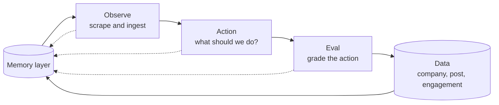

# Contributing

Everyone branches from one shared harness, builds their piece, and merges what works. The [README](README.md) covers setup and commands. This file covers how the team splits the work, where your files go, and what you can't break without telling people.

## How the team splits the loop

The whiteboard splits the work two ways. Each stage of the loop is a column with its own team, and every stage writes to a shared memory layer that feeds the next round:

*Memory is the start of each round, not only the end of it.*

The board also splits the account's work into a reply lane and a post lane. Both run the same three stages, but they need different inputs. A reply needs a live post that is getting traffic right now. An original post needs a story worth starting. The code doesn't split lanes yet: `reply_sniper` is the only reply-only mind, and the other minds draft posts, mentions and follows.

The second row on the board sketches the same loop as an agent. One observation agent reads several feeds and hands an action to eval. Eval for that row is still undesigned. Start with the plain pipeline and make it rough. We improve whatever stage the evals show is weakest.

| Team | Owns | Code | Files |
| --- | --- | --- | --- |
| Observe | Live sources, clustering signals into narratives | `harness/sources/`, `harness/orient.py` | `observation/` |
| Action | The media minds that draft actions | `harness/minds/` | `action/` |
| Eval | Audience panel, critic, backtests against real engagement | `harness/qualify.py` | `eval/` |
| Memory | Run log, outcomes, lessons the minds read | `harness/memory.py`, `harness/learn.py` | `memory/` |
| Data | Backfill of past posts and their engagement | none yet | `data/` |

## Where code and files go

Code lives in the `harness` package, so `python -m harness` can import it. The top-level `observation/`, `action/`, `eval/`, `memory/` and `data/` directories hold each stage's non-code files: datasets, fixtures, eval reports and memory files. `data/sample_signals.json` and `memory/lessons/<profile>.md` already follow this.

To add a data source, subclass `Source` in `harness/sources/`, set `name`, and return a list of `Signal`. Register the class in `REGISTRY` in `harness/sources/__init__.py`, then enable it with `HARNESS_SOURCES`. If the source can't fetch, raise an error that says why. `observe()` prints the error and skips that source, so the run keeps going.

To add a media mind, add a markdown file to `harness/minds/prompts/`. The filename becomes the mind's name.

Put anything about Caitlin Clark or the account in its mission profile or a prompt file, not in Python. The data team's backfill covers dev-tool launches, so the same code has to run for a different brand.

Each brand is a mission profile, a folder under `mission/profiles/` with five files: `mission.md`, `observe.toml` (sources, watch list and `[brand] x_handle`), `panel.json` (the simulated audience), `reply_framing.json` (the handle reply drafts are written under) and `prompts.toml` (the few brand phrases the action prompts insert, such as who counts as a rival). A profile may also hold `takes.json`, a person's own takes. `HARNESS_PROFILE` picks the profile and defaults to `wnba`; `devtools` is the other. Code reads these files only through `config.profile_file()`, which raises an error naming the path when one is missing. Memory follows the profile: the store starts from `memory/seed/<profile>/`, lives in `memory/store/<profile>/`, and `learn` writes `memory/lessons/<profile>.md`. To add a brand, copy a profile folder and edit its five files.

## Shared contracts

Every stage reads these. Change one in its own PR and tell the team before you merge.

- `Signal`, `Narrative`, `Action` and `ACTION_TYPES` in `harness/models.py`.
- The SQLite schema in `harness/memory.py`. `CREATE TABLE IF NOT EXISTS` never adds columns to an existing table, so after a schema change everyone has to delete `data/harness.db`.
- The JSON shape each prompt asks the model for, in the `PROMPT` strings.
- `out/approved-run<id>.json`, the hand-off file for 8VC's Grok bot.

Adding an optional field with a default is safe. Renaming or removing a field breaks every branch that reads it.

## Rules

- The harness recommends and never posts. 8VC's Grok bot decides what goes out on the account. Don't add code that writes to X, even behind a flag.
- Keep the mock provider working. Every `complete_json` call takes a `mock=` that returns the shape its caller reads. `uv run python -m harness run --provider mock` is the only check that runs without an API key, so it has to pass on main.
- Never let a draft invent a fact or a stat. The minds write `[VERIFY: ...]` when they can't check a number. One wrong stat costs a two-follower account more than a missed post.
- Keep keys in `.env`, which git ignores. Don't commit keys, cookies or session tokens.
- Flag engagement you suspect bots or paid boosts pushed. Product launches often get boosted, so a high count doesn't prove the post worked. Mark those rows instead of dropping them, so eval can compare results with and without them.
- When eval says an action failed, decide whether the agent or its input was at fault. A bad draft from good inputs is an action problem. A sensible draft about a dead story is an observe problem. Fix the stage that failed.
- Open files with `encoding="utf-8"` and build paths with `pathlib`. The team runs both Windows and macOS.

## Workflow

1. Pull `main` and run `uv sync`. It installs Python 3.12 and the dependencies from `uv.lock`. On a fresh clone, also run `uv run pre-commit install` to add the commitlint hook.
2. Create a branch named `<your-name>/<topic>`.
3. Build your piece. If the stage before yours isn't ready, use fake inputs and put the fixtures in that stage's directory.
4. Run `uv run python -m harness run --provider mock`, then a real run if you have a key.
5. Write commits and the PR title as [Conventional Commits](https://www.conventionalcommits.org/), with the stage as the scope: `feat(eval): backtest panel against real engagement`. The hook checks commits locally and the `commitlint` job checks every PR.
6. Open a pull request and fill in the template. Paste the output your branch produced, because that output is how we pick what to merge.

If you work with a coding agent, read [CLAUDE.md](CLAUDE.md). It covers how agents coordinate through coordigent.
